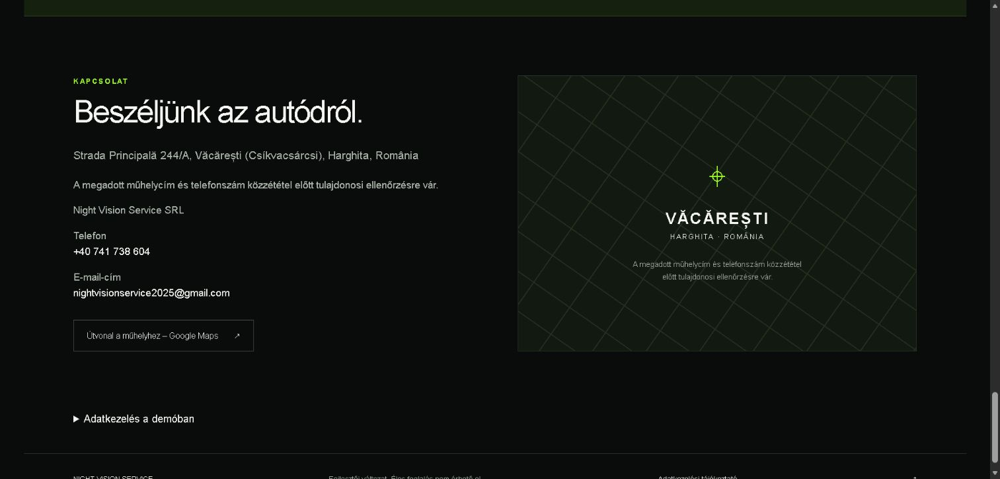
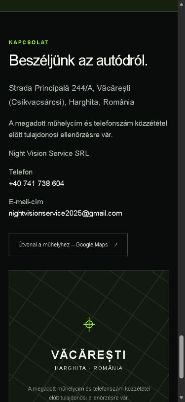

# Issue #1 – fejlesztési és tesztjegyzőkönyv

Kiinduló GitHub-commit: `6c13884f729946386d6f909d5e2064b0af4fadb9` (`dev/website-v1`). Munkavégzés: `feat/issue-1-contact-booking-emulator`. A korábbi helyi és GitHub-commitok eltérő történetűek, mert a feltöltés a GitHub connector Git Data API-ján történt; a PR közvetlenül a GitHub fejlesztői ágából indul.

## Statikus változások

Közös `src/business.mjs` adatok mindhárom nyelven: Night Vision Service SRL, megadott műhelycím, kattintható +40 741 738 604, mailto, az issue-ban szereplő pontos Maps-profil és változatlan appletöltési URL. A cím/telefon tulajdonosi ellenőrzésre jelölt; nem tesszük jóváhagyottként indexelhetővé. JSON-LD: cégnév, e-mail, hasMap és település; streetAddress/telephone kizárólag CONTACT_APPROVED=true esetén. A PRODUCTION=true build ezt az explicit jóváhagyást is igényli. Alapértelmezés: noindex. Új HU/RO/EN adatkezelési tájékoztató oldalak; összesen 24 statikus, sitemapben szereplő oldal.

Hiányzó valódi fotók, cégtörténet és nyitvatartás továbbra sincs kitalálva. A nyilvános időpontkérő továbbra is világosan demó, nem állít foglalást vagy e-mail-küldést. Éles, teljes fiók-/foglalási adatkezelési tájékoztató az integráció előtt szükséges.

## Emulátoros integráció

A külön `emulator/` fa kizárólag `demo-nvs-website` projekttel, helyi Auth/Firestore endpointokkal működik. Az alkalmazás valós Firebase-konfigurációját nem másoljuk át. A backend minden API-hívásnál és outbox-triggernél ellenőrzi ezt a korlátot; valódi projekt vagy hiányzó emulátor esetén zárva marad. A nyilvános GitHub Pages nem tölti be ezt a klienst.

- Firebase Auth: meglévő account belépése, önkéntes signup és emulált e-mail-megerősítés. A backend friss token- és Auth-user-ellenőrzéssel tiltja a nem megerősített/tiltott accountot. Jelszó csak az Auth-emulátorhoz kerül, memóriabeli token, nincs kliensoldali tartós tárolás.
- `customerRegistrations/{uid}`, `cars/{id}`, `vehicleRegistry` az appból olvasott név/mező/UID-kapcsolatokkal. A registry SHA-256 és normalizálás az app algoritmusát követi. Létező járműazonosítót nem ír át, nem veszi tulajdonba; az app jóváhagyott átadása szükséges. Céges regisztráció nincs újraimplementálva: külön meglévő appfolyamat marad.
- Új személyes profil és első saját autó atomikus, megszakítás után idempotensen folytatható. Nem rendel önkényesen műhelyt az autóhoz. Az autó csak a műhelytől kapott hiteles shopId után kérhet időpontot; tesztben ezt admin fixture adja.
- Új `appointments` dokumentum: `source:web`, `pending`, meglévő appkompatibilis mezők, szerveroldali UID/shop/ownership/céges szerep ellenőrzés, idempotenciakulcs és payload-ellenőrzés. A shopId kizárólag szintetikus `nvs-demo-shop`; nem éles azonosító.
- Tranzakciós autó/nap guard, létező app-kérések vizsgálata és determinisztikus ID védi a webes duplikációkat. Egyidejű, azonos kulcsú retry egyetlen kérést hoz létre. Eltérő payload ugyanazzal a kulccsal hiba. Szerveroldali felhasználónkénti 5 új művelet/perc korlát és payloadkorlát.
- Europe/Bucharest: explicit UTC-konverzió, nem létező tavaszi és kétértelmű őszi időpont elutasítása. A kívánt idő nem szabadkapacitás-lista. Az app továbbra is közvetlenül írhat, ezért **teljes műhelykapacitás-védelem nincs**, és ezt nem állítjuk. Közös slot-lock migráció: `docs/FIREBASE-INTEGRATION.md`.
- Atomikus outbox, Firestore onCreate Function és determinisztikus `emulatedMail/{eventId}` sink. Egyetlen külső levél sem megy ki. Tesztelhető deduplikáció, exponenciális backoff, legfeljebb 5 próbálkozás és dead-letter állapot. Külön helyi retry runner kezeli az esedékes sorokat. Éles szolgáltató, Secret Manager és feladói domain külön jóváhagyott adaptert igényel; külső küldés crash/ack deduplikációjához szolgáltatói idempotenciakulcs szükséges.

## Helyi labor

Java 21 és Node 22 szükséges. Kizárólag kitalált adatokkal:

    npm install --prefix emulator --ignore-scripts
    npm install --prefix emulator/functions --ignore-scripts
    npm start --prefix emulator

Másik terminálban (PowerShell):

    $env:GCLOUD_PROJECT='demo-nvs-website'
    $env:FIREBASE_AUTH_EMULATOR_HOST='127.0.0.1:9099'
    $env:FIRESTORE_EMULATOR_HOST='127.0.0.1:8080'
    node emulator/functions/seed.mjs
    $env:EMULATOR_UI='true'
    $env:SITE_URL='http://localhost:4180'
    $env:BASE_PATH='/nvs-website'
    npm run dev

Labor: `/nvs-website/hu/lab/`, `/ro/lab/`, `/en/lab/`. Szintetikus seed-login: `customer@example.invalid` / `Nvs-demo-only-123!`. Új regisztráció ellenőrző linkje az Auth-emulátor naplójában jelenik meg. Megerősítés után új belépés kell. Új profil autója szándékosan nincs műhelyhez rendelve; ez nem a kliens döntése. Az opcionális marketinghozzájárulás külön gyűjtemény, nem feltétele a kérésnek.

    npm test --prefix emulator

A teszt kizárólag a fenti demo projektet használja. Ne futtass `firebase deploy` parancsot. A `firebase.json` és a deny-by-default szabályok kizárólag az izolált emulátorkísérlethez tartoznak, nem az éles app szabályjavaslatának helyettesítői.

## Tesztállapot és technikai akadályok

- Helyi statikus build: sikeres, 24 nyelvi oldal.
- Helyi automatizált teszt: 8 sikeres; gyökérútvonal, Pages-alútvonal, kapcsolati linkek, NAP-gate, lab opt-in, registry, DST és demó.
- Helyi Emulator Suite: nem futtatható ezen a hoston. Az egyetlen talált Java indító hibás (`could not find java.dll`). Az npm registry a sandboxból ENOTFOUND hibát ad; a sandboxon kívüli futtatást az automatikus szabályzat elutasítja. Nem kerültem meg a korlátozást.
- Az emulator workflow Node 22 + Java 21 mellett sikeres: [43645488775](https://github.com/vadzsolty-cloud/nvs-website/actions/runs/43645488775), ellenőrzött kódcommit: `99dc3d07ce4dda6fd44695db982c0c254c35e8ff`. Nyolc statikus/unit teszt és 9 Emulator Suite teszt (8 részteszt + főteszt), 0 hiba, 0 kihagyás. A Pages-ellenőrzés is sikeres: [43645488697](https://github.com/vadzsolty-cloud/nvs-website/actions/runs/43645488697).
- Az első emulátorfuttatás egy 25 karakteres korlátot túllépő szintetikus rendszám-fixture miatt hibázott; a fixture javítva, a bemeneti korlát megmaradt. Az ezt követő teljes integrációs futtatások sikeresek. A teszt valódi Auth/Firestore/Functions emulátorokkal, nem mockolt Firebase SDK-val futott.
- Asztali és 390 × 844 px mobilos helyi Edge-ellenőrzés: kapcsolati cím/tel/mail/Maps/app href, HU és RO adatkezelési oldal és nyelvváltás sikeres. Az első stale-tab hiba friss előnézeti lappal megszűnt. A lab HTTP-útvonalait, JS-/fordításfájlját és szűk CSP-jét a CI tényleges HTTP-kérésekkel ellenőrizte; a teljes lab UI kézi bejelentkezési folyamata helyben a Java-korlát miatt nem volt végigkattintható.
- Nem történt éles Firebase-olvasás/írás, Rules-/Functions-deploy, app- vagy APK-módosítás. Nem volt új nyilvános weboldal-publikálás ezen a feature ágon.

## Éles bekötéshez még szükséges

Hiteles és jóváhagyott projektazonosító, NVS shopId, telepített Auth-providerek/action domainek, valós szabályok/indexek és runtime állapot; jármű-műhely összerendelés üzleti jóváhagyása; feladó/domain/Secret Manager és e-mail-szolgáltató; szerveroldali App Check és periméter abuse-védelem; élő adatkezelési tájékoztató és jóváhagyott cím/telefon. Ezek hiányában a nyilvános felület demó marad. A közös account/app-megjelenés igazolása az emulált adatmodellre és appazonos query-re vonatkozik, nem a valódi APK-ban tesztelt éles megjelenésre.

Forrásdokumentáció: https://firebase.google.com/docs/emulator-suite/connect_auth és https://firebase.google.com/docs/emulator-suite/connect_firestore

## Review-képernyőképek

A képek helyi review-buildről készültek. A nyilvános oldal nem frissült ettől a PR-től. A draft PR: https://github.com/vadzsolty-cloud/nvs-website/pull/2; az issue nyitva marad az éles konfiguráció, ellenőrzött cégadatok, éles adatkezelés és release-jóváhagyás rendezéséig.
